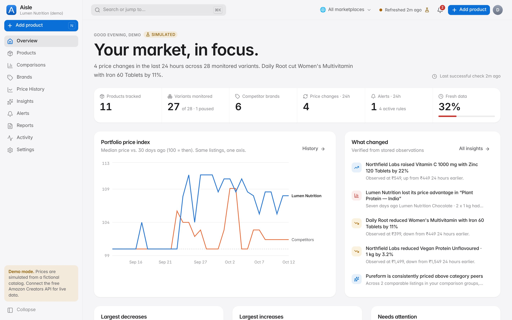
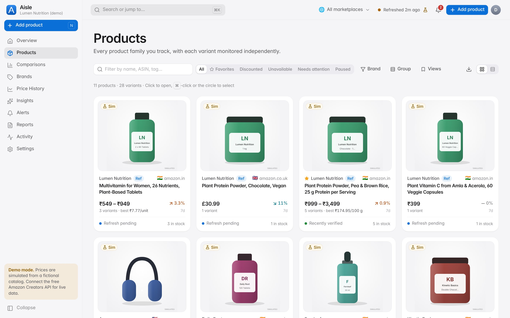
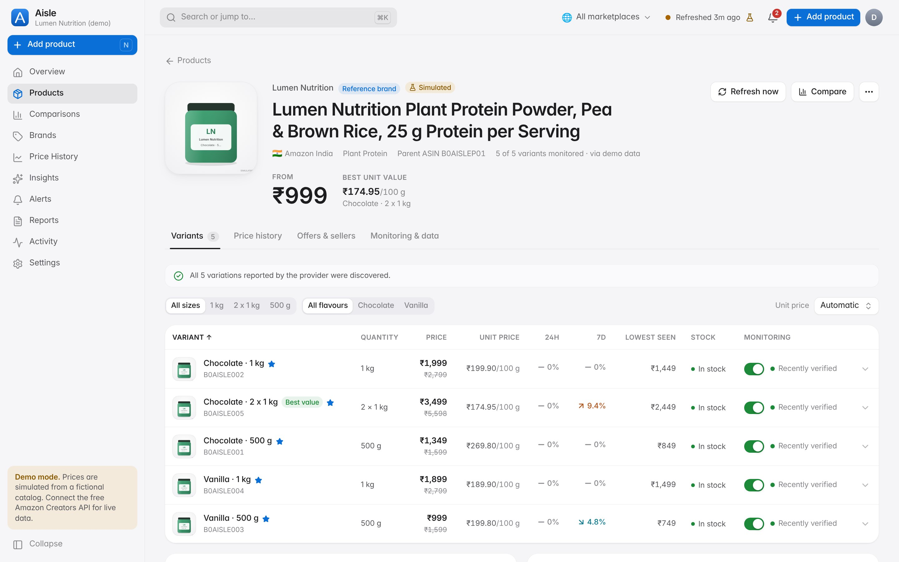
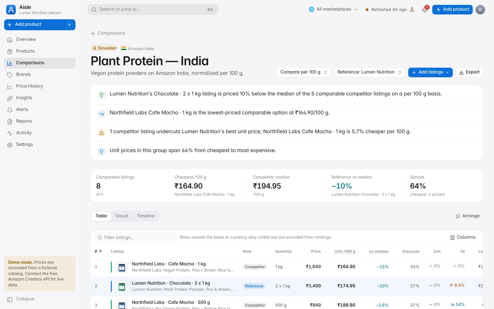
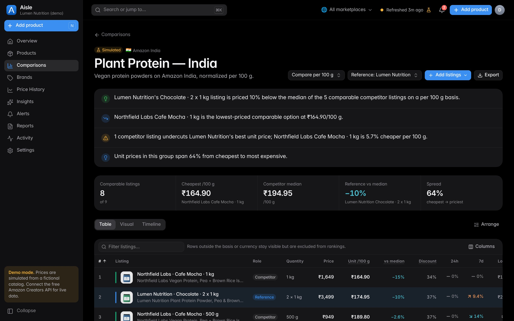
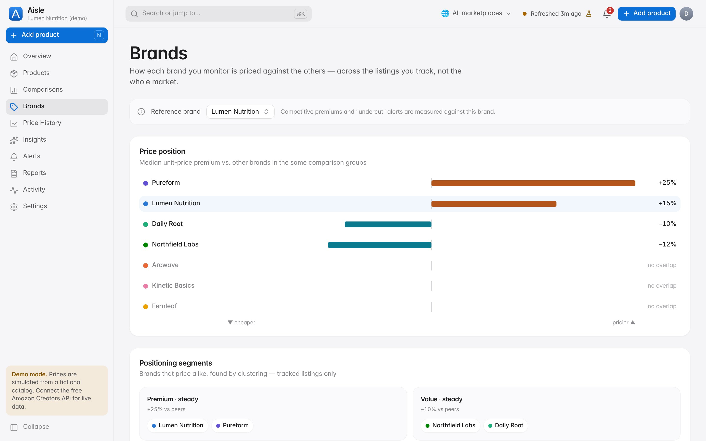
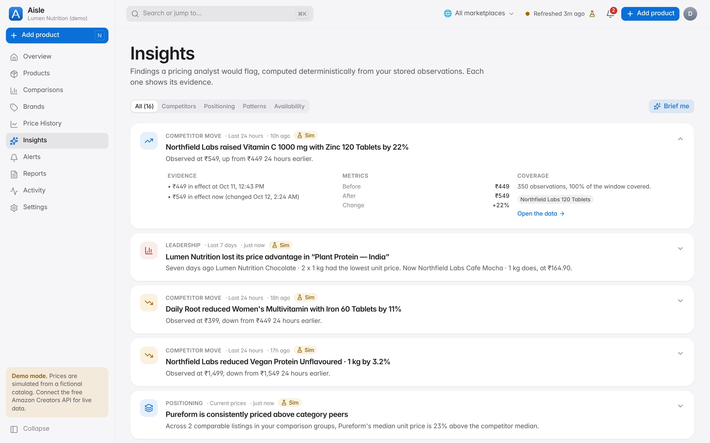

# Aisle — Price Intelligence

Aisle is a price-intelligence workspace for brand teams selling on Amazon. Paste a product link and Aisle finds every variant, monitors prices hourly and normalizes them to a fair unit price (per 100 g, per tablet, per ml). It then shows where you stand against competitors with comparisons, history, insights, alerts and reports.

It runs entirely on **free** infrastructure, and the only data sources it integrates are **free** ones.



| | |
|---|---|
|  |  |
|  |  |
|  |  |

## What it does

- **Import:** Amazon URLs, short links and ASINs across 19 marketplaces. Variants are discovered automatically and pack sizes are parsed into normalized quantities, which you can edit.
- **Monitoring:** hourly checks with idempotent jobs, retries, exponential backoff and quota pauses. Freshness is tracked as verified, provider-stale, pending, failed, paused or unavailable.
- **Unit pricing:** integer minor units throughout; per 100 g, kg, 100 ml, l, unit, serving or pack; confidence recorded for every quantity.
- **Comparisons:** Table, Visual and Timeline views. A reference brand, premiums against the competitor median, undercut detection, suggestions, drag-to-arrange and a compare tray.
- **History:** gap-aware step charts (prices are never interpolated), time-weighted statistics and event markers.
- **Insights:** rule-based findings plus **local, free ML**: robust z-score anomalies, trend regression, promotion-cycle autocorrelation, k-means brand segments and TF-IDF comparison suggestions. Each finding shows its evidence and method.
- **My brand:** tell Aisle which brand is yours. It keeps a "{Brand} vs Market" comparison for every category and unit you sell in, and lists what can't be compared yet, and why.
- **Protect My Brand:** one switch turns on alerts for undercuts, leadership changes, your own stock-outs and rivals' drops of 5% or more.
- **Monday Briefing:** last week in one read (your position, movers, undercuts, sharp drops, trend, data confidence), stored with an archive.
- **Bulk work:** import any number of links in the background, 25 at a time, with a result per link. Edit brand, monitoring frequency or tags across many products at once.
- **Alerts and notifications:** rules with deduplication, an in-app inbox, and optional email through Resend's free tier, with a delivery log and retries.
- **Reports:** seven report types in CSV, XLSX and PDF, with methodology notes. Simulated data is labelled in every export.
- **Product polish:** the ⌘K palette, onboarding, saved views, light and dark themes, reduced motion and transparency, and phone, tablet and desktop layouts.

## Data: what's real and what's simulated

| Mode | Status |
|---|---|
| **Demo** (default, free) | Fully working and tested end to end. All prices come from a fictional catalog and are labelled **Simulated** everywhere |
| **Amazon Creators API** (free with an approved Associates account) | Implemented and fixture-tested, but **not yet verified with live credentials**. The app labels it "Not yet verified live" until a real response is recorded |

Aisle never scrapes Amazon. See [docs/PROVIDERS.md](docs/PROVIDERS.md).

## Quick start (local)

Requires Node 22+, pnpm (`corepack enable`) and Docker (or your own Postgres 14+).

```bash
pnpm install
cp .env.example .env
docker compose up -d        # Postgres + Redis
pnpm setup                  # migrate + seed the demo workspace
pnpm dev                    # http://localhost:3000 → "Explore the demo workspace"
pnpm worker                 # background monitoring (BullMQ, needs REDIS_URL)
```

There's no need to run Redis: leave `REDIS_URL` blank and run `pnpm worker:once` on a schedule instead.

## Deploy for free

Use Vercel Hobby, Neon Postgres and GitHub Actions for the hourly monitoring cron. No Redis and no paid APIs are needed. Follow the step-by-step guide in **[docs/DEPLOYMENT.md](docs/DEPLOYMENT.md)**, which also covers self-hosting with Docker.

## Scripts

| Command | Purpose |
|---|---|
| `pnpm dev` / `build` / `start` | Next.js |
| `pnpm worker` | BullMQ worker (scan every 5 min, hourly alerts, daily maintenance and reports) |
| `pnpm worker:once [--daily]` | One monitoring pass, for cron-based hosting |
| `pnpm db:migrate` / `db:seed [--force]` / `db:reset` | Database |
| `pnpm lint` / `typecheck` / `test` / `test:e2e` | Quality gates |

## Tests

Results at the latest commit:

| Check | Result |
|---|---|
| `pnpm lint` | 0 errors (2 warnings: TanStack Table is incompatible with the React Compiler, expected) |
| `pnpm typecheck` | Pass |
| `pnpm test`: unit, components, integration | 172 passed (the integration suite also passes with Redis unset) |
| `pnpm test:e2e`: Playwright, desktop + mobile, includes axe | 21 passed |
| Production build | Pass, with `REDIS_URL` unset |

Visual and motion QA, with frame capture, runtime metrics and before/after numbers, is documented in [docs/QA_REPORT.md](docs/QA_REPORT.md).

## Documentation

- [Architecture](docs/ARCHITECTURE.md)
- [Database](docs/DATABASE.md)
- [Data providers](docs/PROVIDERS.md)
- [Design system](docs/DESIGN_SYSTEM.md)
- [Motion spec](docs/MOTION_SPEC.md)
- [Deployment (free)](docs/DEPLOYMENT.md)
- [Brand intelligence release: features 1–6, migration and release checklist](docs/BRAND_INTELLIGENCE.md)
- [QA report](docs/QA_REPORT.md)

## Limitations

- Live Amazon data depends on Creators API access, which Amazon grants to approved Associates accounts. That adapter is unverified against real responses.
- The Creators API returns current offers only, so history builds from the day monitoring starts. It is lookup-only unless you acknowledge that your Associates agreement permits storing prices.
- Currencies are never converted. Cross-marketplace views compare percentage changes instead.
- The rate limiter is per instance, which is best-effort on serverless hosts.
